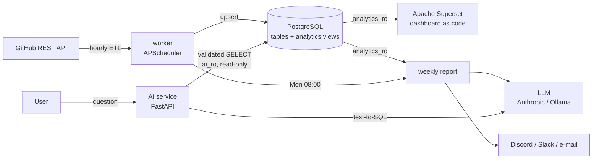
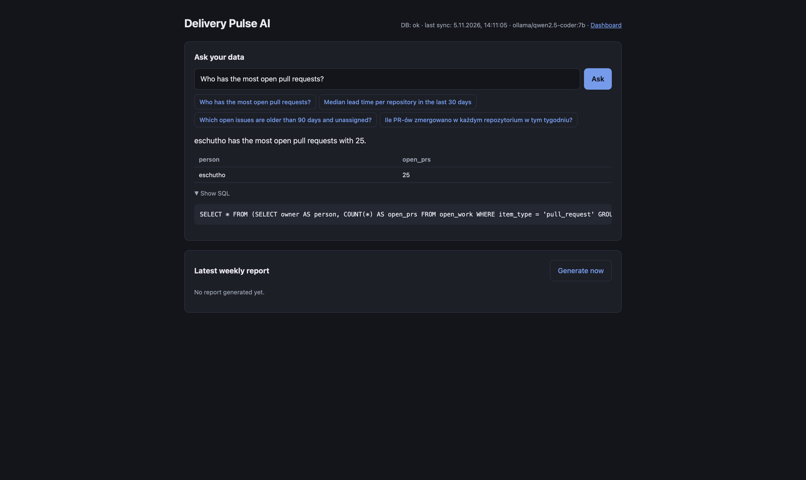

# Delivery Pulse

**Delivery analytics for engineering teams, from the GitHub API to an Apache Superset dashboard and an AI weekly report, all started with one `docker compose up`.**

Delivery Pulse pulls pull requests, issues and commits from GitHub and stores them in PostgreSQL. It shows throughput, lead time, work in progress and workload in **Apache Superset**. A **language model** writes a weekly status report and sends it to Discord, Slack or e-mail. It also answers questions about the data in plain Polish or English, with SQL guardrails at three levels.


## Architecture



| Service | What it does | URL |
|---|---|---|
| `db` | PostgreSQL 16: raw tables, analytics views, least-privilege roles | `localhost:5433` |
| `worker` | ETL every hour (incremental), weekly AI report on a cron schedule | – |
| `ai` | "Ask your data" web UI + REST API, latest report | http://localhost:8000 |
| `superset` | Dashboard imported automatically from YAML on start | http://localhost:8088 |

## Features

- **Integration / ETL.** GitHub REST API client with `Link`-header pagination and rate-limit handling. The first run loads everything in full, later runs only fetch what changed. Writes are idempotent upserts, and every run is logged in `etl_runs`.
- **Delivery metrics.** Throughput, median PR lead time, work in progress by age, oldest open work and workload per person, defined as SQL views. Bots and draft PRs are excluded.
- **Dashboards as code.** The Superset dashboard is kept as YAML in `superset/dashboards/` and imported on every start. `make export-dashboards` saves changes made in the UI back to the repo.
- **AI weekly report.** Pre-computed metrics (JSON) go to an LLM, which writes a Markdown report. The report is saved to a file and the database, then sent to Discord (split to fit the message limit), Slack (converted to mrkdwn) or e-mail (HTML).
- **Ask your data.** A question goes to the LLM, which writes SQL. The SQL is validated and run read-only, and the LLM then answers in the language of the question. If the validator or the database rejects a query, the error goes back to the model for one retry.

## Security of LLM-generated SQL

The model is never trusted. Three independent layers stand between it and the data:

1. **Validator** (`sqlglot` AST, `pulse/sql_guard.py`). Allows exactly one `SELECT`, only from allow-listed analytics views. It blocks DML/DDL, `SELECT INTO`, `FOR UPDATE`, other schemas (`pg_catalog`, `information_schema`) and dangerous functions (`pg_sleep`, `pg_read_file`, `set_config`, `dblink`, …), and adds a `LIMIT`.
2. **Database role `ai_ro`.** `SELECT` only on the analytics views (not even on the raw tables), with `default_transaction_read_only = on`.
3. **Resource limits.** A 5 s `statement_timeout` is set on the role and again per query, plus a row limit.

The integration tests check that layer 2 holds **even if the validator is bypassed**. PR titles are untrusted input too: report HTML is escaped and only `http(s)` links are allowed (tested against an XSS payload).



## Quick start (macOS / Linux)

Requirements: Docker Desktop. Python is not needed on the host, because everything runs in containers.

```bash
cp .env.example .env
python3 -c "import secrets; print(secrets.token_urlsafe(42))"   # paste into SUPERSET_SECRET_KEY
# set GITHUB_TOKEN and ANTHROPIC_API_KEY (or LLM_PROVIDER=ollama) in .env
make up          # first build takes a few minutes
make logs        # watch the first ETL run, Ctrl+C to leave
make open        # dashboard (admin / admin) + AI service
```

## Commands

```
make up / down / ps / logs     lifecycle
make etl / etl-full            run the ETL now
make report / report-dry       weekly AI report now (dry = no LLM call)
make ask q="..."               ask your data from the terminal
make test / test-all           unit tests / unit + integration (separate pulse_test DB)
make export-dashboards         save dashboard changes from the UI into the repo
make psql                      SQL shell
make reset                     delete all data
```

## Tests and CI

There are 59 pytest tests. GitHub API calls are mocked with `responses` and the LLM with fakes, so the tests run offline and cost nothing.

- unit: API client (pagination, rate limits), transforms, metrics, SQL validator (allowed and blocked queries), notifications, scheduler, REST API
- integration (real PostgreSQL): full and incremental ETL, all views, locked-down `ai_ro` role, ask-your-data end to end, report generation, XSS escaping

GitHub Actions runs every test against a Postgres service container and builds all Docker images.

## Project structure

```
app/pulse/        etl.py, github_client.py, metrics.py, report.py, notify.py,
                  llm.py, sql_guard.py, ask.py, api.py, worker.py, static/index.html
app/tests/        pytest suite
db/init.sql       schema, analytics views, roles
superset/         image, bootstrap (auto-import), dashboards/ (YAML export)
```

## Design decisions

- **SQL views as the semantic layer.** Superset, the report and the LLM all use the same metric definitions.
- **Pure metric functions** (`metrics.py`) keep the report logic testable without a database.
- **The LLM gets numbers, not raw data.** The report prompt contains only aggregated JSON and the model is told not to invent data. `--dry-run` shows exactly what would be sent.
- **Swappable LLM.** Use the Anthropic API, or a free local model with Ollama.
- **Least privilege everywhere.** Three database roles, ports bound to `127.0.0.1`, containers running as non-root, and no secrets in git (Superset exports have masked passwords, and the real URI is injected at start-up).

## Next steps

- Jira as a second data source
- Review metrics: time to first review, review rounds, PR size
- Repository filter for the AI service, and caching of repeated questions
- Report delivery as a Superset alert/report with a dashboard snapshot
